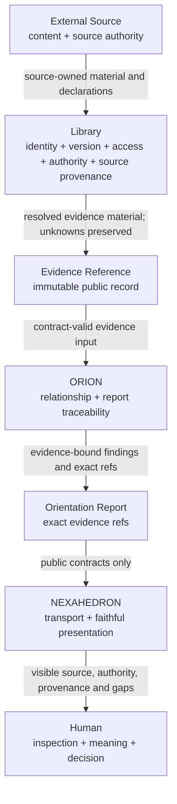

# NEXAH Evidence Architecture

- Current status: Active research / derived reference
- Previous status: Canonical architectural reference (preserved for lineage)
- Authority: no Library, source-authority, or ORION authority is created by
  this NEXAHEDRON document
- Scope: immutable evidence boundary between external sources, Library,
  NEXAHEDRON, ORION and the Human
- Public contract: `orion.evidence-reference/1.0`
- Runtime implementation: existing ORION Version 1 consumer only
- Library implementation: pending
- Effects: none

## 1. Purpose

This document answers five questions:

1. What is an `EvidenceReference`?
2. Which authority creates each part of it?
3. How does evidence remain traceable, versioned and reproducible?
4. What may ORION rely on, and what must remain uncertain?
5. How may future Libraries participate without changing ORION?

It defines ownership and invariants. It does not define storage, retrieval,
ingestion, search, indexing, ranking, APIs or implementation technology.

The frozen Version 1 `EVIDENCE_REFERENCE.md` specification in the immutable
ORION dependency remains normative for the public object. Its verified source
is recorded in the
[`ORION Version 1 source manifest`](../upstream/orion-v1/SOURCE.yaml). This
blueprint explains the ecosystem boundary around that contract and does not
amend it.

The ownership choreography for report-specific evidence is resolved by the
canonical
[`Evidence Binding Architecture`](EVIDENCE_BINDING_ARCHITECTURE.md). It selects
separate source-side evidence and ORION-owned report binding as the future
boundary while preserving the frozen Version 1 composite contract unchanged.

Normative terms **MUST**, **MUST NOT**, **SHOULD**, **SHOULD NOT** and **MAY**
have their conventional architectural meaning.

## 2. Foundational statement

Information already exists in external sources. Evidence is not created merely
by copying that information into another system.

Evidence exists for an Orientation Report only when all of the following remain
explicit:

- the exact source and source version;
- the exact fragment or explicit absence of fragment identity;
- the owner and authority of the declarations;
- the provenance path from source to evidence record;
- the evidence class and its validation state;
- the relationship to a specific report target;
- the exact Evidence Reference identity and version.

An `EvidenceReference` is therefore an immutable, versioned traceability record.
It describes how declared material relates to exact public report content. It
is not the source material, not a content container, not a search result, not a
confidence score and not proof that a claim is true.

## 3. Core concepts

### 3.1 Raw document

A raw document is source-owned material in its original authoritative context:
a book, paper, repository file, dataset, image, web page, record or other
source object.

The document remains owned and versioned by its external source or declared
source authority. A Library may register and resolve it but MUST NOT silently
replace its identity or claim ownership of its content.

### 3.2 Source Reference

A Source Reference identifies one exact source state through:

- `source_id`;
- `source_version`;
- `identity_domain`;
- `source_owner`;
- `source_ref`;
- optional `fragment_ref`;
- optional `integrity_ref`.

`source_id + source_version + identity_domain` identifies the declared source
state. It is distinct from Evidence Reference identity.

### 3.3 Fragment

A fragment is an addressable part of an exact source version: a passage,
section, page region, image region, row, column, cell, field, commit range or
equivalent source-defined unit.

A fragment inherits the source identity and version. `fragment_ref` MUST be
interpretable only within the declared identity domain. A Library MUST NOT
present an unstable display offset as a stable fragment identity unless the
source domain defines that stability.

When no stable fragment exists, `fragment_ref` remains absent. The gap MUST NOT
be hidden by fabricating an identifier.

### 3.4 Citation

A citation is a Human-readable or publication-specific expression that helps a
person locate material. It may be derived from a Source Reference, but it is not
the Evidence Reference and is not authoritative identity unless the source
domain explicitly declares it so.

Formatting a citation belongs to presentation. Resolving its underlying source
identity belongs to the Library or source authority.

### 3.5 Evidence Reference

An Evidence Reference is the public Version 1 record identified by
`evidence_id + evidence_version`.

It binds five distinct declarations without merging their authority:

1. source identity;
2. authority and editorial status;
3. evidence class and relationship;
4. ordered provenance and validation;
5. traceability to exact report targets.

The same source fragment used with different relationships—such as `supports`
and `limits`—requires distinct Evidence Reference identities. The same source
may therefore participate in multiple evidence records without becoming
multiple sources.

### 3.6 Authority

Authority states who owns a declaration and in which domain. It does not state
that the declaration is universally true.

Editorial status, source ownership, evidence class, validation and report
relationship are separate properties. None may be inferred from another.

### 3.7 Confidence

Evidence References do not carry general confidence scores. Their
`validation.status` states whether declared checks passed, failed or remain
unverified. Evidence levels apply only when an authoritative Evidence or
Transition Contract defines the scale.

Report confidence belongs to the Orientation Report. Human trust and judgment
belong to the Human. Neither may be written back into the Evidence Reference as
if it were source authority.

### 3.8 Provenance

Provenance is the ordered path from the source toward the evidence record. Each
step declares its inputs, output, owner, governing contract when applicable and
lossiness.

Provenance describes what happened. It does not automatically validate the
result, promote its authority or erase declared loss.

### 3.9 Traceability

Traceability points from an Evidence Reference to an exact report identity,
report version and public target path. It may additionally name a finding.

Traceability answers “where is this evidence used?” Provenance answers “where
did this evidence come from?” They are complementary and MUST NOT be collapsed.

## 4. Non-overlapping responsibilities

| Boundary | Sole responsibilities | Must never own |
|---|---|---|
| External source | original content, source identity when available, source versions, publisher declarations, source-native fragments, licensing and access terms | ORION report relationship, Library validation, Human meaning |
| Library | source resolution, Library registry identity, version resolution, access state, authority declarations, source/fragment integrity checks, source-side provenance, immutable evidence-record custody and portability | orientation, report findings, report relationship, Human decisions |
| ORION | determine relevance within confirmed Scope, preserve evidence class, bind the declared `relationship`, create report `traceability`, validate public contracts and evidence use, expose gaps and counterevidence | source ownership, editorial promotion, retrieval, Library mutation, Human meaning |
| NEXAHEDRON | collect Human-confirmed object and intention, transport exact public objects, preserve ordering, display evidence fields and empty states, provide inspectable navigation to permitted sources | evidence selection, evidence validation, authority inference, metadata repair, source copying, report interpretation |
| Human | intention, permission to use supplied material, interpretation, assessment of sufficiency, acceptance of uncertainty, continuation and decisions | silent alteration of source identity or historical evidence records |

### 4.1 Field authority

An Evidence Reference is a composite contract. No subsystem owns the entire
meaning of every field.

| Field group | Declaring authority | ORION treatment |
|---|---|---|
| `source` | external source or Library acting as declared resolver | preserve exactly; never invent missing identity |
| `authority` | Library or named editorial authority | preserve as declaration; never promote |
| `evidence_class` | owner of the observation, derivation or proposal declaration | verify compatibility with provenance; never silently change |
| `relationship` | ORION for the exact report use | bind explicitly; one relationship per evidence version |
| `provenance` | owner of each declared step; Library preserves the ordered record | inspect continuity, loss and governing contracts |
| `validation` | declared validator in its named domain | require supported status and keep issues visible |
| `traceability` | ORION | bind only to exact report version and public target path |
| `access_status` | source or Library access authority | respect; never treat as access grant |
| `evidence_id`, `evidence_version` | Version 1 composite issuer; future source-side and report-binding issuers are separated by the Evidence Binding Architecture | treat as immutable public identity |

Custody does not transfer declaration authority. A Library may store an
ORION-owned relationship or traceability value without becoming its semantic
owner. ORION may consume a Library-issued evidence identity without acquiring
editorial authority.

## 5. Evidence lifecycle

The lifecycle is a sequence of responsibility transfers, not a database state
machine.

1. **Existence** — material exists under an external source authority.
2. **Registration** — a Library records or resolves source identity without
   replacing external ownership.
3. **Version resolution** — the exact source version is established or remains
   explicitly `unknown`.
4. **Fragment resolution** — an exact fragment is resolved when the source
   supports stable fragments.
5. **Authority declaration** — the responsible authority and editorial status
   are recorded as declarations.
6. **Provenance declaration** — every known source, representation, transition,
   derivation or proposal step is ordered; gaps remain visible.
7. **Source-side validation** — declared checks establish resolution,
   integrity, access and provenance status within the Library's authority.
8. **Orientation binding** — ORION determines the evidence relationship and
   binds traceability to an exact report target.
9. **Public issuance** — the Version 1 composite issuer assigns immutable
   `evidence_id + evidence_version` to the complete record. This Version 1
   lifecycle is not authority for a future Library to originate ORION-owned
   fields; the selected future split is defined in the Evidence Binding
   Architecture.
10. **Consumption** — ORION returns the exact reference with the report;
    NEXAHEDRON renders it without promotion or omission.
11. **Human inspection** — the Human may inspect accessible source context,
    provenance, validation, limitations and counterevidence.
12. **Continuity** — later changes create new source, authority or evidence
    versions; the historical record remains unchanged.

An Evidence Reference MUST NOT be mutated after public issuance. Correction,
withdrawal, changed access, improved provenance or changed relationship creates
a new Evidence Reference version or a distinct Evidence Reference identity as
required by the frozen contract semantics.

## 6. Evidence flow

### 6.1 Transition rules

#### External Source → Library

- The source retains ownership.
- The Library records the identity domain and exact version.
- Access or licensing constraints remain visible.
- Copying content does not create Library editorial authority.

#### Library → Evidence Reference

- The Library supplies only declarations within its authority.
- Unknown owner, version, fragment, integrity or provenance remains `unknown`
  or absent as required by the public contract.
- Validation describes completed checks; it does not assert truth.
- Issuance freezes the complete reference payload for that evidence version.

#### Evidence Reference → ORION

- Transport preserves exact identity, version, order and field values.
- ORION rejects unsupported contract versions visibly.
- ORION does not retrieve missing content or repair Library metadata.
- ORION may use evidence only within the Human-confirmed Scope and relationship.

#### ORION → Orientation Report

- Every substantive finding has an exact Evidence Reference or a visible
  evidence gap.
- Supporting, countering, contextualizing and limiting relationships remain
  distinct.
- Traceability targets the exact report version and public path.
- Evidence inclusion never implies editorial promotion.

#### Orientation Report → Human

- NEXAHEDRON displays exact public fields and empty states.
- Accessible sources may be opened but never edited through evidence
  inspection.
- Restricted, unavailable, invalid and unverified evidence remains visible.
- The Human decides whether the evidence is sufficient for the intended use.

## 7. Identity model

### 7.1 Identity layers

| Identity | Meaning | Owner |
|---|---|---|
| source identity | the underlying work, object or source record | external source or its identity authority |
| source version | one exact state, edition, revision or release | external source or version authority |
| fragment reference | one source-addressable part of that version | source identity domain |
| Evidence Reference identity | one relationship-specific evidence record | issuing evidence registry |
| report identity | one immutable Orientation Report version | ORION |
| traceability target | one public location inside that report version | ORION |

Identity equality is exact. Similar titles, matching content, copied files,
equivalent URLs or semantic resemblance do not establish shared identity.

### 7.2 Evidence identity invariants

1. `evidence_id + evidence_version` identifies exactly one immutable payload.
2. Reusing that pair for different source, authority, provenance, relationship,
   validation or traceability is forbidden.
3. Evidence identity is distinct from source identity.
4. An importing Library preserves existing evidence identity only when the
   complete payload is unchanged.
5. A changed relationship or report target requires a new evidence record or
   version according to the issuing registry's declared policy.
6. Local storage identifiers never replace public identity.

## 8. Version model

### 8.1 Independent versions

The following versions are independent and MUST remain visible:

- public `schema_version`;
- `evidence_version`;
- `source_version`;
- `authority_version`;
- provenance `contract_version`;
- `report_version`;
- optional evidence-scale version.

Changing one does not silently change another.

### 8.2 Change and supersession

A new Evidence Reference version is required when any declared property of the
evidence record changes, including:

- corrected source or fragment identity;
- new or corrected provenance;
- changed authority declaration;
- changed validation outcome;
- changed access state when represented in the public record;
- changed relationship;
- changed traceability target;
- corrected integrity declaration.

The prior version remains addressable. Supersession means “a later declaration
exists”; it does not rewrite history or make the prior report invalid.

Version 1.0 contains no public supersession pointer or expiration timestamp.
Libraries MAY maintain version lineage in their own registries, but consumers
MUST NOT invent such fields inside the frozen contract. A future public lineage
mechanism requires separate contract governance.

### 8.3 Historical reproducibility

An Orientation Report remains reproducible when it retains:

- exact report identity and version;
- exact `evidence_id@evidence_version` references;
- the immutable Evidence Reference payload used at report creation;
- exact source and authority versions;
- complete declared provenance and validation state;
- visible unavailable or unresolved material.

A historical report records what ORION could validly orient from at that time.
It does not promise that a source remains accessible, current or authoritative
forever.

## 9. Authority model

Authority is declared, scoped and versioned.

- `source_owner` owns the source declaration.
- `authority_owner` owns the editorial-status declaration within
  `authority_domain`.
- provenance-step owners own their step declarations.
- the validation owner is identified by the declared checks and governing
  contract context.
- ORION owns relationship and report traceability.
- the Human owns meaning and consequential decisions.

Popularity, format, ranking, inclusion, fluent explanation, Library custody or
ORION use MUST NOT promote authority.

When authority cannot be established, the value remains `unknown`. Unknown
authority may still orient by exposing a gap, conflict or limitation, but it
MUST NOT be presented as reviewed or published evidence.

## 10. Validation model

Validation is layered. Passing one layer does not imply passing another.

### 10.1 Source and Library validation

The Library may validate:

- source resolution;
- exact source version;
- fragment resolution;
- declared integrity coverage;
- access state;
- declared authority status;
- continuity and lossiness of Library-owned provenance steps.

The Library guarantees only that its declared checks were performed and
recorded faithfully. It does not guarantee the truth of source claims.

### 10.2 Public contract validation

The ORION Gateway validates Version 1 structure, required values, identities,
versions and cross-contract invariants. Contract validity does not establish
evidential relevance or truth.

### 10.3 ORION evidence-use validation

ORION validates:

- compatibility with confirmed Scope;
- explicit evidence class and relationship;
- provenance continuity and visible loss;
- supported validation state;
- exact traceability to findings;
- preservation of counterevidence and limitations;
- evidence coverage and remaining gaps.

ORION MUST NOT upgrade `invalid` or `unverified` evidence to `valid`, infer
missing authority or replace evidence gaps with narrative confidence.

### 10.4 Human assessment

The Human determines whether the visible evidence, limitations and uncertainty
are sufficient for the Human's purpose. This assessment is a decision, not an
Evidence Reference validation field.

## 11. Trust model

### 11.1 What ORION may rely on

ORION may rely on:

- a successfully validated public contract having the declared structure;
- exact identity and version values as declarations;
- validation checks having the status explicitly recorded;
- the Library being authoritative only within its declared domain;
- integrity only to the method and coverage declared;
- access only to the stated access condition.

### 11.2 What ORION must verify or preserve

ORION must verify or preserve:

- supported contract version;
- identity and version completeness;
- provenance continuity and lossiness;
- evidence class and relationship compatibility;
- traceability to exact report targets;
- counterevidence, invalid evidence and unresolved gaps;
- separation of source authority, editorial authority and report use;
- Human-confirmed Scope.

ORION must not treat a Library result as truth merely because it came from a
Library.

### 11.3 What the Library guarantees

A conforming Library guarantees that:

- identities and versions are stable within their declared domains;
- returned declarations are not silently rewritten;
- access and authority states are explicit;
- provenance gaps and transformation loss remain visible;
- issued Evidence Reference versions are immutable;
- the same evidence identity/version resolves to the same payload;
- imported evidence preserves its origin and authority.

### 11.4 What remains Human responsibility

The Human remains responsible for:

- choosing the Orientation Object and intention;
- permission to provide or inspect restricted material;
- evaluating source suitability and evidence sufficiency;
- interpreting what the orientation means;
- accepting uncertainty;
- choosing continuation or ending the session;
- every consequential decision.

## 12. Expiration and continuity

Evidence does not disappear from history when its current conditions change.

Possible changes include:

- access becomes restricted or unavailable;
- a source version is withdrawn;
- editorial status changes;
- an integrity check fails;
- provenance is corrected;
- a newer source edition appears;
- the governing evidence scale is superseded.

These changes MUST NOT mutate a historical Evidence Reference. A Library issues
a new version or a new record and retains the prior version for historical
resolution when legally and technically possible.

If the prior source can no longer be accessed, historical identity, provenance,
authority, validation and the last declared access state remain inspectable.
NEXAHEDRON shows the current inability to open the source without implying that
the historical report never existed.

“Expired” MUST NOT mean “deleted,” “false” or “never used.” Version 1 has no
generic expiration field. Any future expiration policy belongs to a declared
Library or evidence policy and cannot be inferred by ORION.

## 13. Evidence transport

Transport carries public contracts; it does not create evidence semantics.

A conforming transport MUST:

- preserve exact field values, order, identity and versions;
- preserve `unknown`, absent and empty values distinctly;
- reject unsupported major contract versions visibly;
- avoid embedding source content unless a separately authorized content
  transfer exists;
- avoid granting access through the reference itself;
- avoid reclassifying relationships or validation status;
- keep transport errors separate from evidence invalidity;
- transmit no provider, prompt, orchestration or private Runtime information.

Encryption, authentication, serialization and network protocol are
implementation concerns outside this blueprint. They may change without
changing Evidence Reference behavior.

## 14. Evidence portability and multiple Libraries

ORION depends only on the public Evidence Reference contract. It MUST NOT
depend on Library storage layout, database identifiers, repository structure,
search technology or publisher-specific APIs.

For frozen Version 1 composite Evidence References, multiple Libraries may act
as custodians when each preserves:

- public evidence identity and version;
- source identity domain and owner;
- authority owner and domain;
- ordered provenance and lossiness;
- validation checks and issues;
- access state;
- relationship and traceability without reinterpretation.

An importing Library has two valid choices for a Version 1 composite:

1. preserve the exact Evidence Reference unchanged;
2. refuse import while preserving the reason.

It MUST NOT reissue a changed composite because that would also reissue
ORION-owned relationship and traceability. Future source-side evidence
portability follows the separate ownership model in the Evidence Binding
Architecture.

Future Atlas integration may index or visualize Evidence Reference identities
and their relations. The Atlas does not acquire source, Library, ORION or Human
authority. Atlas mutation and publication remain separately governed effects.

## 15. Canonical invariants

1. An Evidence Reference is a reference record, not evidence content.
2. Evidence identity and source identity remain distinct.
3. `evidence_id + evidence_version` identifies one immutable payload.
4. Source owner, editorial authority, evidence class, relationship, validation
   and confidence remain separate.
5. The Library owns source-side declarations; ORION owns report relationship
   and traceability.
6. NEXAHEDRON transports and presents; it never selects or validates evidence.
7. The Human owns meaning, sufficiency judgment and decisions.
8. Unknown is preserved; it is never repaired by inference.
9. Counterevidence and limiting evidence remain first-class.
10. Provenance is ordered, owned and loss-aware.
11. Traceability reaches exact report identity, version and public path.
12. Validation states performed checks; it does not assert truth.
13. Access status does not grant access.
14. Later versions never rewrite historical reports.
15. Portability preserves origin and authority.
16. No Library implementation detail crosses the ORION boundary.

## 16. Future compatibility

This architecture supports multiple Libraries, publishers, repositories and
storage systems through stable public behavior. The frozen Version 1 composite
remains valid for historical custody; a normal production Library integration
requires the future major contract boundary selected by the Evidence Binding
Architecture.

A future Library conforms when:

- it can resolve or explicitly fail to resolve exact source identity/version;
- it preserves external ownership;
- it issues immutable source-side evidence records and never ORION report
  bindings;
- it exposes authority, provenance, validation and access without promotion;
- it stores ORION-owned report bindings only as distinct foreign immutable
  records;
- it transports exact public contracts;
- it preserves historical versions and portability;
- after the separately governed Evidence Binding Contract Major Revision, it
  requires no Library-specific ORION Runtime or Gateway behavior.

New storage, indexing, federation, caching, synchronization, Atlas views or
publisher connectors are replaceable implementation choices. They do not alter
the evidence boundary.

## 17. Open questions

These questions require future governance before implementation. They do not
authorize new fields, APIs or behavior.

The former Version 1 binding-choreography question is resolved by
[`EVIDENCE_BINDING_ARCHITECTURE.md`](EVIDENCE_BINDING_ARCHITECTURE.md): no
Library-side Version 1 workaround is permitted, and the selected future split
requires major contract governance.

1. Which registry is the primary issuer of globally portable source evidence
   identity values when multiple Libraries participate?
2. How is a Library's version lineage exposed outside the frozen Version 1
   contract without weakening historical immutability?
3. Which authority defines source-specific stable fragment schemes?
4. How are current access changes shown beside an immutable historical access
   declaration without rewriting it?
5. Which integrity methods and coverage vocabularies are approved per source
   domain?
6. How are cross-Library identity collisions detected and governed?
7. Which evidence or transition contracts may define evidence-level scales?
8. What is the authorized boundary for opening restricted source content from
   NEXAHEDRON?
9. Which minimum provenance checks are required for each evidence class?
10. How will Atlas references preserve evidence versions and authority without
    becoming a second Library?

Until resolved, these values remain explicit unknowns or unavailable
capabilities. Implementations MUST NOT choose silent defaults.

## 18. Non-goals

This blueprint does not define or authorize:

- a Library implementation;
- ingestion or content extraction;
- crawling, search, ranking or indexing;
- databases, object stores or cache policy;
- Library APIs or transport endpoints;
- authentication or authorization mechanisms;
- source-content copying;
- evidence selection or relevance algorithms;
- automated editorial approval;
- truth scoring or synthetic confidence;
- provider or model behavior;
- Atlas mutation or publication;
- changes to ORION Version 1 contracts, Gateway or Runtime;
- a LUCY reflection implementation.

No implementation work should begin until the open ownership and identity
questions required by the chosen Library scope are resolved through the
appropriate governance process.
